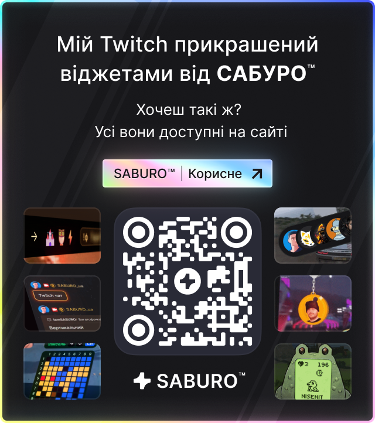
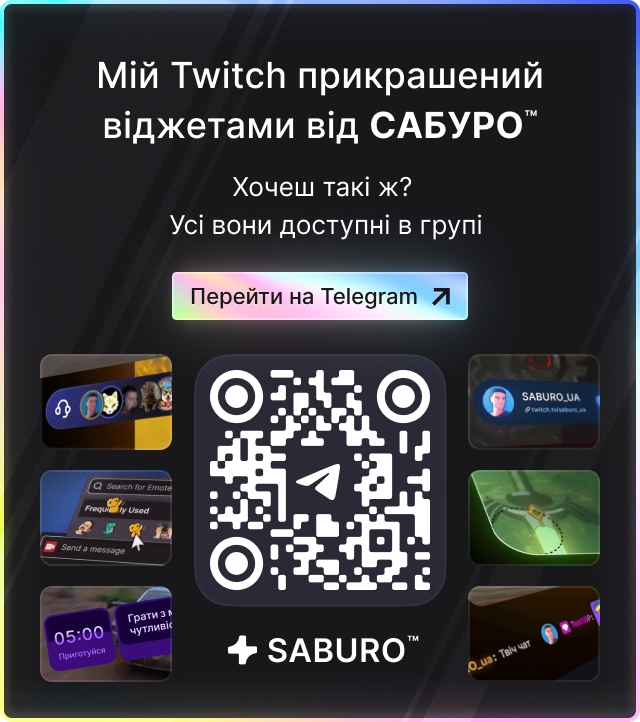
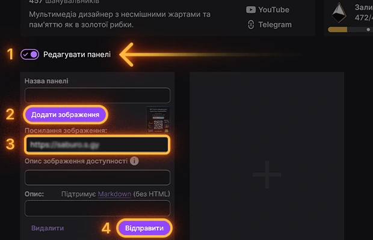

# Підтримай проект!
Встанови собі в описі каналу банер нашої спільноти.

<video autoplay loop muted playsinline style="max-width:100%; border-radius:4px; display:block;">
  <source src="webm/SABURO_ThankYou.webm" type="video/webm">
</video>

## БАНЕРИ НА ВИБІР:

  <nav class="tabs-nav" role="tablist">
    <button class="tab-btn active" data-tab="tab-site" role="tab" aria-selected="true">
      
      Сайт
    </button>
    <button class="tab-btn" data-tab="tab-tg" role="tab" aria-selected="false">
      
      Telegram
    </button>
    <button class="tab-btn" data-tab="tab-dc" role="tab" aria-selected="false">
      
      Discord
    </button>
  </nav>

  <!-- Tab: Сайт -->
  

    <h3 style="margin-top:1.5; margin-bottom:0.3rem;">Посилання для банера:</h3>
    <code style="font-size:1rem; font-weight:700; line-height:1.3; word-break:break-all; cursor:pointer;"
          title="Клікни щоб скопіювати">https://saburo.s.gy</code>

    

      

        
        <a class="btn-saburo" data-visual="pill" data-icon-visual="download"
           style="--btn-w:100%; --btn-h:40px; --radius:4px; margin-top:0.8rem;"
           href="/webp/SABURO_WEB_MEDIUM.png" download="SABURO_WEB_MEDIUM.png" target="_blank">
          download
          Завантажити
        </a>
      

      

        
        <a class="btn-saburo" data-visual="pill" data-icon-visual="download"
           style="--btn-w:100%; --btn-h:40px; --radius:4px; margin-top:0.8rem;"
           href="/webp/SABURO_WEB_SMALL.png" download="SABURO_WEB_SMALL.png" target="_blank">
          download
          Завантажити
        </a>
      

    

  

  <!-- Tab: Telegram -->
  

    <h3 style="margin-top:1.5; margin-bottom:0.3rem;">Посилання для банера:</h3>
    <code style="font-size:1rem; font-weight:700; line-height:1.3; word-break:break-all; cursor:pointer;"
          title="Клікни щоб скопіювати">https://t.me/saburo_ua</code>

    

      

        
        <a class="btn-saburo" data-visual="pill" data-icon-visual="download"
           style="--btn-w:100%; --btn-h:40px; --radius:4px; margin-top:0.8rem;"
           href="/webp/SABURO_TG_MEDIUM.png" download="SABURO_TG_MEDIUM.png" target="_blank">
          download
          Завантажити
        </a>
      

      

        
        <a class="btn-saburo" data-visual="pill" data-icon-visual="download"
           style="--btn-w:100%; --btn-h:40px; --radius:4px; margin-top:0.8rem;"
           href="/webp/SABURO_TG_SMALL.png" download="SABURO_TG_SMALL.png" target="_blank">
          download
          Завантажити
        </a>
      

    

  

  <!-- Tab: Discord -->
  

    <h3 style="margin-top:1.5; margin-bottom:0.3rem;">Посилання для банера:</h3>
    <code style="font-size:1rem; font-weight:700; line-height:1.3; word-break:break-all; cursor:pointer;"
          title="Клікни щоб скопіювати">https://discord.gg/kcqHYQ9dSf</code>

    

      

        
        <a class="btn-saburo" data-visual="pill" data-icon-visual="download"
           style="--btn-w:100%; --btn-h:40px; --radius:4px; margin-top:0.8rem;"
           href="/webp/SABURO_DS_MEDIUM.png" download="SABURO_DS_MEDIUM.png" target="_blank">
          download
          Завантажити
        </a>
      

      

        
        <a class="btn-saburo" data-visual="pill" data-icon-visual="download"
           style="--btn-w:100%; --btn-h:40px; --radius:4px; margin-top:0.8rem;"
           href="/webp/SABURO_DS_SMALL.png" download="SABURO_DS_SMALL.png" target="_blank">
          download
          Завантажити
        </a>
      

    

  

## ЯК ДОДАТИ БАНЕР:

---

<h2 style="margin-top:3rem;">💛 Дякую за підтримку:</h2>

---

Ваша підтримка мотивує мене робити ще більше цікавих штучок для стрімерів і розвивати українське 💙💛