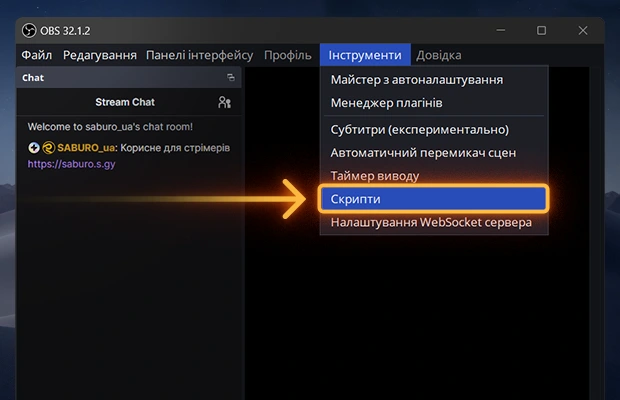

## ❇️ OBS Мультишейдер `v26.10`

###### ( тільки Windows )

  <a class="btn-saburo" data-visual="rainbow" data-hover="rainbow" data-icon-visual="add_circle" data-icon-hover="add_circle" style="--btn-w:180px;--btn-h:47px;--radius:30px;" href="/obs-multishader-access">
    add_circle
    add_circle
    Встановити
  </a>

Один **багатофункціональний фільтр для OBS**, який додає професійні **ефекти** до ваших джерел. **Більше не потрібно встановлювати безліч плагінів щоб просто закруглити кути чи додати тінь**.
‎ 
## ОСНОВНІ ФУНКЦІЇ
> 💡 **Ambilight-підсвітка** за джерелом  
> ⏺️ **Закруглення кутів** джерела  
> 🖼️ **Рамка** навколо джерела  
> 🌒 **Тінь** з налаштуваннями  
> 🪄 **Кінематографічний** шум  
> 🔦 **Підсвічування** темних джерел  
> ↔️ **Додаткові відступи** навколо джерела  
> 🚀 **Дуже просте** встановлення  